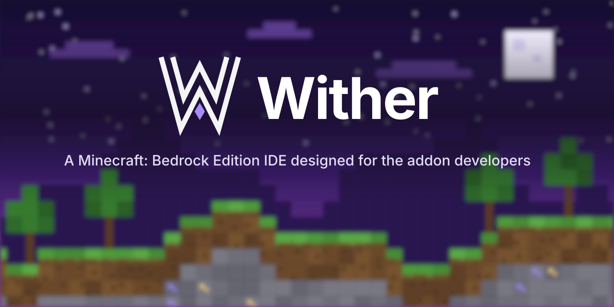

<p align="center"></p>

# Wither

Wither is a native desktop IDE for Minecraft Bedrock Edition addon development, built with Rust and Tauri.

This first milestone is the IDE shell: title bar, explorer, workspace search, editor tabs, a lightweight code editor, bottom panel with a real system terminal, status bar, command palette and themes. Workspaces are served from mock data for now. Linting, validation, packaging and Minecraft integration come later.

## Layout

| Path | Purpose |
| --- | --- |
| apps/desktop | React and TypeScript frontend (Vite) |
| apps/desktop/src-tauri | Tauri app crate (wither-desktop), IPC commands and app state |
| crates/core | Shared app types and settings (wither-core) |
| crates/terminal | Pty sessions running the user's shell for the terminal panel (wither-terminal) |
| crates/workspace | Workspace tree, in memory files, search and the sample project (wither-workspace) |
| assets | Logos and banners |

## Requirements

Rust 1.80+, Node 20+, and the Tauri system dependencies for your platform (on Linux: webkit2gtk 4.1 and GTK 3).

## Development

```sh
cd apps/desktop
npm install
npm run dev        # launches the app with hot reload
npm run build      # release build and bundles
```

Rust tests run from the repository root:

```sh
cargo test --workspace
```

## Keyboard

| Action | Keys |
| --- | --- |
| Command palette | Ctrl+Shift+P |
| Go to file | Ctrl+P |
| Open workspace | Ctrl+O |
| Search in workspace | Ctrl+Shift+F |
| Toggle sidebar | Ctrl+B |
| Toggle bottom panel | Ctrl+J |
| Toggle terminal | Ctrl+` |
| Terminal copy / paste | Ctrl+Shift+C / Ctrl+Shift+V |
| Save / Save all | Ctrl+S / Ctrl+Alt+S |
| Close tab | Ctrl+W |
| Next / previous tab | Ctrl+Tab / Ctrl+Shift+Tab |
| Editor font size | Ctrl+= / Ctrl+- / Ctrl+0 |
| Settings | Ctrl+, |

## Contributing

See [CONTRIBUTING.md](CONTRIBUTING.md) for setup, checks and commit conventions. Report security issues as described in [SECURITY.md](SECURITY.md).
